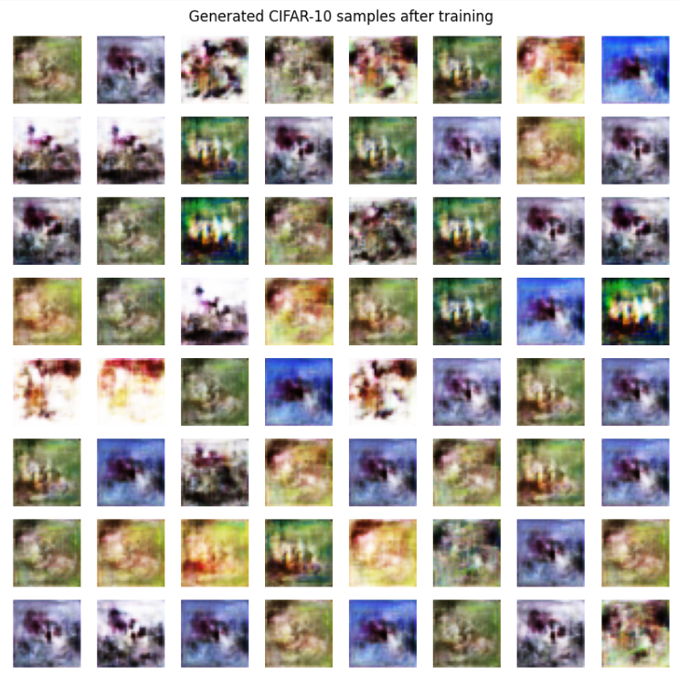
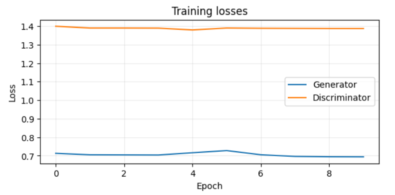
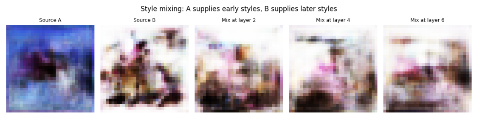
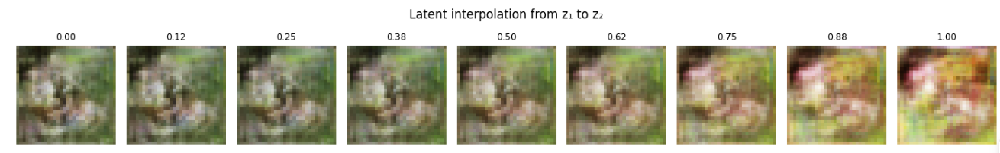

# StyleGAN Image Generation Experiment

## Overview

This project implements and analyzes a **Style-Based Generative Adversarial Network (StyleGAN)** for synthetic image generation using deep learning.

The experiment demonstrates how StyleGAN generates realistic images by controlling different image features through a latent space representation.

The project includes implementation of:

* Mapping Network
* Style-based Generator
* Adaptive Instance Normalization (AdaIN)
* Discriminator Network
* Style Mixing
* Latent Space Interpolation

---

# Project Objectives

The main objectives of this project are:

* Understand the working mechanism of StyleGAN architecture.
* Implement a GAN-based image generation model.
* Study how latent vectors control image generation.
* Analyze the effect of style mixing and latent interpolation.
* Generate synthetic images using deep learning.

---

# Technologies Used

| Technology         | Purpose                              |
| ------------------ | ------------------------------------ |
| Python             | Programming language                 |
| TensorFlow / Keras | Deep learning framework              |
| NumPy              | Numerical operations                 |
| Matplotlib         | Visualization                        |
| Google Colab       | Model training environment           |
| GitHub             | Project management and documentation |

---

# Model Architecture

The StyleGAN architecture consists of two major components:

## 1. Generator Network

The generator creates synthetic images from random latent vectors.

Architecture flow:

```
Random Noise (z)
        |
        ↓
Mapping Network
        |
        ↓
Latent Vector (w)
        |
        ↓
Style Blocks
(AdaIN + Styled Convolution)
        |
        ↓
Generated Image
```

---

## 2. Discriminator Network

The discriminator determines whether an input image is real or generated.

```
Input Image
      |
      ↓
Convolution Layers
      |
      ↓
Classification
      |
      ↓
Real / Fake Output
```

---

# Dataset

The experiment uses the **CIFAR-10 dataset**.

Dataset contains:

* 60,000 colour images
* 10 different classes
* Image size: 32 × 32 pixels

The images are normalized before training.

---

# Experiments Performed

## Experiment 1: Image Generation

Random latent vectors are provided to the generator to create new synthetic images.

Output:

* Generated image samples
* Visualization of generated images

---

## Experiment 2: Style Mixing

Style mixing combines different latent vectors to study how different layers control image features.

Observation:

* Early layers control major structures.
* Later layers control fine details and appearance.

---

## Experiment 3: Latent Space Interpolation

Two latent vectors are smoothly combined to generate intermediate images.

Observation:

* The generated images transition smoothly between two different samples.

---

# Results

## Generated Images




## Training Loss




## Style Mixing




## Latent Interpolation



---

# Repository Structure

```
StyleGAN-Image-Generation

│
├── StyleGAN_Experiment.ipynb
│
├── README.md
│
├── requirements.txt
│
└── results
    |
    ├── generated_images.png
    ├── loss_curve.png
    ├── style_mixing.png
    └── latent_interpolation.png
```

---

# How to Run the Project

### Step 1: Clone Repository

```
git clone https://github.com/jyoshithareddychennuru/StyleGAN-Image-Generation.git
```

### Step 2: Install Dependencies

```
pip install -r requirements.txt
```

### Step 3: Open Notebook

Open:

```
StyleGAN_Experiment.ipynb
```

Run all cells in Google Colab or a local Python environment.

---

# Future Improvements

Future work can include:

* Training on high-resolution datasets.
* Implementing StyleGAN2/StyleGAN3.
* Using larger datasets such as FFHQ.
* Improving image quality using advanced GAN techniques.
* Evaluating generated images using FID score.

---

# Conclusion

This project demonstrates the working principle of StyleGAN and its ability to generate synthetic images using deep learning.

Through experiments such as style mixing and latent interpolation, the project shows how StyleGAN provides control over image generation through learned style representations.

---

# Author

**chennuru Jyoshitha**

Deep Learning Project

GitHub: https://github.com/jyoshithareddychennuru/StyleGAN-Image-Generation
